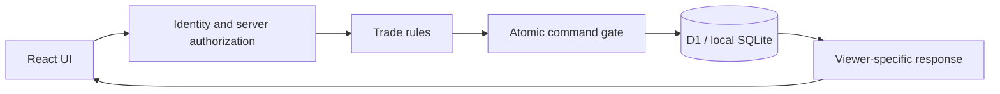

# Trade Ledger · 交換帳本

**A full-stack trade planner originally built for Pokémon GO communities.**

Share what you can offer and what you want, browse friends' lists, and arrange two-way trades in private groups. Trade Ledger keeps track of what is available, what has been promised, and what has actually been exchanged—even when the same listing is shared with several groups.

[繁體中文](README.zh-TW.md) · [Try locally](#try-it-locally) · [Engineering decisions](#engineering-decisions) · [Code walkthrough](docs/PORTFOLIO.md) · [CI results](https://github.com/HaNa-486/PokemonGOTradeListTool_public/actions/workflows/ci.yml)

## The problem it solves

A list in a chat or spreadsheet tells people what you have. Coordinating a trade also means answering: **Has someone already reserved it? Did both people accept the latest proposal? How much of the exchange is complete?**

For example, a player offers three items across two groups. Reserving two in one group must leave only one available in both:

| Step | Held | Reserved | Available across both groups |
|---|---:|---:|---:|
| Share one listing with two groups | 3 | 0 | 3 |
| Agree to trade two items | 3 | 2 | 1 |
| Confirm delivery of one item | 2 | 1 | 1 |

The application records and coordinates exchanges people arrange themselves. It does not connect to game accounts or execute in-game trades.

## What you can do

**List → browse or match → propose → both agree → reserve → report and confirm.**

- **Organize private trading groups:** invite and approve members, share the same supply/demand records across circles, and grant scoped management access.
- **Find and propose exchanges:** browse a member's full shared list or use condition-aware matching. You can offer something even when the recipient has not posted a matching request.
- **Track a trade through completion:** revise both sides of a proposal, reserve stock after agreement, complete it in batches, and record corrections.
- **Control your view and recover data:** personal hide/restore is separate from circle-wide moderation; personal export/import and maintenance backup tools have their own access rules.

The interface is primarily **Traditional Chinese**, with phone layouts, distinct offer/request modes, and system/light/dark themes.

<p>
  
  
</p>

The community edition includes **six original fictional species** for a reproducible local demo. Screenshots use those entries and synthetic accounts. Real game catalogs and artwork are not bundled.

## Engineering decisions

| Problem | Design choice and reason | Inspect the implementation |
|---|---|---|
| The same stock appears in several groups. | **One listing, many visibility shares.** Quantity and progress belong to one record; sharing never creates a second inventory. | [Model](core/model.ts) · [Persistence](core/store.ts) · [Ledger tests](tests/ledger.test.ts) |
| Two requests compete for the last unit, or a client retries. | **Atomic commands with content-bound retry receipts.** An epoch/version check and SQL CHECK guard protect one D1 batch containing the ledger changes, audit and receipt. Failure rolls back the batch; a repeated request cannot deduct twice or reuse its key for different content. | [Command gate](core/store.ts) · [Local D1 tests](tests/d1.test.ts) |
| A proposal changes before reservation, or a trade completes in stages. | **Consent belongs to a proposal revision.** Edits reset agreement. Reserved quantities, completion batches and corrections are tracked explicitly, so users can see what was agreed and what changed. | [Trade rules](core/service.ts) · [Completion tests](tests/ledger.test.ts) |
| Private groups overlap and members have different powers. | **Authorize on the server, then project the response for that viewer.** Current permissions apply to both new and replayed commands; responses omit unauthorized circle references. | [API](server/api.ts) · [Replay checks](core/replay.ts) · [Response projection](server/projection.ts) |

These choices have costs. The **global epoch creates write contention**; it favors a small, testable consistency mechanism over maximum throughput. Explicit agreement adds steps to the user flow. Viewer-specific responses also require permission-aware tests. These are deliberate tradeoffs, not a claim of internet-scale capacity.

Domain details matter too: **unknown, absent, false and unrestricted are different states**. An unspecified form or shiny condition must not silently merge with a known normal item. See [architecture and tradeoffs](docs/ARCHITECTURE.md) for the full model.

## Stack and request path

- **UI:** React, TypeScript and Tailwind CSS.
- **Application runtime:** Vinext/Vite on a Worker, with server-side API and authentication adapters.
- **Data:** Cloudflare D1; SQLite-backed local D1 for the demo; Drizzle schema/migrations and Zod validation.
- **Verification:** Node tests, local D1 integration tests, Playwright browser journeys, Python repository checks and GitHub Actions.



Business records live in the backend database. Browser storage is used for preferences and unsent drafts. Updates are polled while the app is active.

## Try it locally

Use **Node.js 24, npm and Git**; contributor checks also use **Python 3.12**. No cloud account or OAuth credentials are needed for the local demo.

```sh
git clone https://github.com/HaNa-486/PokemonGOTradeListTool_public.git
cd PokemonGOTradeListTool_public
npm ci
npx playwright install chromium
npm run build
npm run demo:setup
```

On Linux, use `npx playwright install --with-deps chromium` if Chromium's system libraries are missing. Initial installation can take several minutes.

Start the server in one terminal:

```sh
npm run demo:start
```

In a second terminal, open the two demo users:

```sh
npm run demo:open
```

This opens **Alex · 示範甲** and **River · 示範乙** in isolated browser contexts at `https://127.0.0.1:8787`. Keep both terminals running; pressing Enter in the second closes the browser windows.

**Your first exchange:**

1. In Alex's window, create a circle under **圈子**, then create an invitation. Open the link in River's already signed-in window and request to join; Alex approves.
2. In each account, choose **新增供需 → 我可提供**. Alex adds `10001` 紙翼 / Paperwing; River adds `10002` 燈芽 / Lamplume. Use the standard form, no costume, and quantity **3** each. Check the circle under **分享範圍**.
3. Browse the other member's list, choose **向他主動提案**, and propose **2** items from each side. Once both agree, each listing has 2 reserved and 1 available.
4. Report **1** item in each direction, then confirm that batch from the other account. Each listing now has 2 held, 1 reserved and 1 available.

The [step-by-step walkthrough](docs/PORTFOLIO.md#local-walkthrough) includes exact quantities and expected results.

Setup creates users only—no circles or inventory—and refuses existing demo state. Sessions last **24 hours**; within that period, resume with `demo:start` and `demo:open`, without repeating setup. For expired sessions or troubleshooting, follow [local setup and recovery](docs/DEPLOYMENT.md).

The demo uses the actual API and persistent local D1 with seeded test sessions. It validates the business workflow, **not real Google/ChatGPT login**. Hosting and real authentication require separate configuration and verification; see [deployment](docs/DEPLOYMENT.md).

## Verification and current limits

The recorded baseline passed **68 application tests, 20 sync/publication tests and 8 repository-guard tests**, plus two Chromium journeys against local D1. The journeys cover bilateral trade revision, reservation, partial completion and visibility recovery. Editor checks use widths 360, 390, 430, 768 and 1280 in light/dark modes. See the [verification record](docs/VERIFICATION.md) and [actual CI runs](https://github.com/HaNa-486/PokemonGOTradeListTool_public/actions/workflows/ci.yml).

To reproduce the contributor checks:

```sh
npm run check:repository
npm run test:repository
npm run check:public
npm run test:public
npm run typecheck
npm test
npm run build
```

After a build and one-time demo setup, stop any running demo server and run `npm run demo:ci`. It starts its own loopback server on port 8787, runs both browser journeys, and shuts that server down. With an existing `demo:start` server, `npm run demo:qa` runs the exchange journey only. CI does not deploy or use production secrets.

**Remaining work:**

- Real-provider login, deployed authentication boundaries and two real cloud users still need acceptance testing. Safe cross-provider account linking is not implemented.
- Physical-device and accessibility testing, production capacity and production disaster recovery remain unverified.
- Independent persisted plan `draft`/`disputed` states are not implemented; complementary matching does not compute every unloaded page at once.

## Use, contribute or extend

- **Try the product:** follow the local walkthrough above. The bundled demo can run without access to the original application.
- **Contribute:** start with a reproducible bug, clearer documentation, accessibility improvements or a regression test. Read [CONTRIBUTING.md](CONTRIBUTING.md); discuss substantial feature changes in an issue first.
- **Bring a catalog:** follow [DATASETS.md](docs/DATASETS.md) and document its rights/provenance. A ledger binds to the exact catalog identity and hash; even a catalog update needs a new database or separately reviewed migration.
- **Operate or maintain it:** use the [deployment](docs/DEPLOYMENT.md), [backup](docs/BACKUP.md) and [source synchronization](docs/SYNC.md) guides.
- **Report a vulnerability:** use the private process in [SECURITY.md](SECURITY.md).

## Project ownership and license

The owner defined the product needs, supplied usage feedback and made release decisions. Development is AI-assisted: Codex helped with implementation, tests and documentation. The [portfolio walkthrough](docs/PORTFOLIO.md) connects those decisions to code and reproducible scenarios.

Original code, documentation, tests and fictional demo data use the [MIT license](LICENSE); third-party components retain their [own notices](THIRD_PARTY_NOTICES.md). MIT does not grant rights to third-party trademarks or game assets.

This is an independent project, not affiliated with or endorsed by Pokémon, Nintendo, Niantic, Scopely or OpenAI. The repository name reflects its original Pokémon GO use case.
