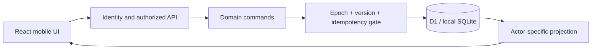

# 交換帳本 · Trade Ledger

**A multi-user exchange ledger with private circles, shared inventory, and consent-based settlement.**

[繁體中文](README.zh-TW.md) · [Architecture](docs/ARCHITECTURE.md) · [Portfolio walkthrough](docs/PORTFOLIO.md) · [Verification](docs/VERIFICATION.md)

Trade planning becomes difficult when one item is shared across several groups, two people reserve the last available unit, or an exchange completes in stages. Trade Ledger models those situations explicitly: a single inventory record, versioned proposals, atomic reservations, and an auditable confirmation process.

This repository is the independently runnable portfolio and community edition. It ships **six original, fictional catalog entries and synthetic demo accounts**. It does not ship a real game's catalog, mined translations, artwork, private user data, or a production deployment binding.

## See it locally

The demo uses the actual application API and a persistent, SQLite-backed local D1 database. Two isolated browser contexts represent two synthetic users. Seeded sessions make that local walkthrough possible; they do **not** demonstrate real OAuth or add a production login bypass.

<p>
  
  
</p>

No public hosted demo is promised. Screenshots and the local walkthrough use synthetic data; verification scope is recorded in [VERIFICATION.md](docs/VERIFICATION.md).

## Quick start

Prerequisites: **Node.js 24, npm, Python 3.12, and Git**. The first dependency and browser installation may take several minutes. The local demo does not require a cloud account or OAuth credentials.

```sh
git clone https://github.com/HaNa-486/PokemonGOTradeListTool_public.git
cd PokemonGOTradeListTool_public
npm ci
npx playwright install chromium
npm run typecheck
npm test
npm run build
npm run demo:setup
```

Keep the local server running in one terminal:

```sh
npm run demo:start
```

In another terminal:

```sh
npm run demo:open
```

The demo opens two browser contexts at `https://127.0.0.1:8787`. Keep that terminal open while using the two windows; press Enter there when you want to close both. Follow the [guided walkthrough](docs/PORTFOLIO.md#local-walkthrough). On Linux, Chromium may require additional operating-system libraries; install them using Playwright's documented browser requirements for your distribution.

`demo:setup` is a one-time step for a fresh checkout: it refuses **any existing demo state or session file**. It creates two sessions valid for 24 hours, not pre-populated circles or inventory. To resume during that period, run only `demo:start` and `demo:open`. See the deployment guide for expired-session recovery; do not bypass checks or point it at a real database. Ordinary browsers without a seeded session remain signed out. See [deployment and local setup](docs/DEPLOYMENT.md) for details.

## What is implemented

| Area | Behavior | Boundary |
|---|---|---|
| Private circles | Invitations, membership approval, roles, scoped delegation | Server authorization is required on every operation |
| Supply and demand | Exact conditions, sharing, search, member browsing | Sharing uses the same listing ID and quantity across circles |
| Matching and proposals | Condition-aware matching and unsolicited bilateral proposals | A recipient does not need an existing demand record |
| Reservations | Both parties accept the same proposal revision | A change resets consent; insufficient quantity fails the whole operation |
| Settlement | Partial reporting, confirmation, correction, retained history | A report alone does not silently deduct stock |
| Visibility | Personal hide/restore and separate circle moderation | Administrator removal is explicitly circle-wide |
| Recovery | Personal export, validated import, restricted full backup and isolated restore | Local restore is not a production disaster-recovery guarantee |
| Presentation | Mobile layouts, supply/demand distinction, system/light/dark themes | Physical-device and assistive-technology acceptance remain separate work |
| Authentication | Sites identity adapter and Google OIDC implementation | Real credentials and deployed trust boundaries require independent validation |

The UI is primarily Traditional Chinese. It retains domain-specific vocabulary from its original exchange use case, while the bundled catalog is entirely fictional.

## Engineering decisions

- **One inventory record, many audiences.** Sharing changes visibility, not stock ownership or quantity.
- **Atomic business commands.** An epoch check and SQL CHECK guard protect a D1 batch containing entities, shares, audit events, and idempotency receipts. A failed precondition rolls the batch back.
- **Content-bound retries.** Reusing an idempotency key with a different payload fails; a replay also rechecks current authorization.
- **Explicit unknown values.** UNKNOWN, NONE, false, and ANY are different states. Exact merging does not silently broaden conditions.
- **Consent survives only the agreed revision.** Partial completion and corrections remain explicit records rather than overwriting history.



The single global epoch keeps concurrency behavior understandable but creates write contention. This design has no claimed internet-scale throughput. See [architecture and tradeoffs](docs/ARCHITECTURE.md).

## Development and verification

```sh
npm run check:repository
npm run test:repository
python scripts/check-public-content.py --history
npm run typecheck
npm test
npm run build
```

After preparing and starting the local demo, `npm run demo:qa` exercises the synthetic browser journey. The [CI workflow](.github/workflows/ci.yml) verifies source and dependencies without deploying, reading cloud data, or using production secrets. A workflow file or a local pass does not prove that a hosted CI run passed; see the [verification record](docs/VERIFICATION.md).

Known remaining work includes real-provider login and deployment verification, safe cross-provider account linking, physical-device/accessibility acceptance, production capacity, and a production recovery rehearsal. There is no independent persisted plan `draft`/`disputed` state, and complementary matching does not compute every unloaded page at once.

## Contribute and reuse

[CONTRIBUTING.md](CONTRIBUTING.md) explains focused changes, tests, and review expectations. Report vulnerabilities through the private process in [SECURITY.md](SECURITY.md), not a public issue containing credentials or private data.

Original application code, documentation, tests, and the fictional demo catalog are licensed under [MIT](LICENSE). Third-party notices remain in [THIRD_PARTY_NOTICES.md](THIRD_PARTY_NOTICES.md). MIT does not grant rights to third-party trademarks or game assets. Custom catalogs must have their own documented rights and provenance. Catalog ID, version, kind, schema version, and content hash are bound to the ledger; even a normal content update needs a controlled migration or a new database. See [DATASETS.md](docs/DATASETS.md).

This is an independent project, not affiliated with or endorsed by Pokémon, Nintendo, Niantic, Scopely, or OpenAI. The repository name reflects the original use case; the public demo contains no real Pokémon dataset.

Development is AI-assisted: the project owner supplied product requirements, usage feedback, and release decisions; Codex assisted implementation, testing, and documentation. The portfolio emphasizes explainable decisions and reproducible evidence, not claims of entirely handwritten code. Read the [engineering walkthrough](docs/PORTFOLIO.md).

[Deployment](docs/DEPLOYMENT.md) · [Backups](docs/BACKUP.md) · [Dataset contract](docs/DATASETS.md) · [Maintenance and synchronization](docs/SYNC.md)
