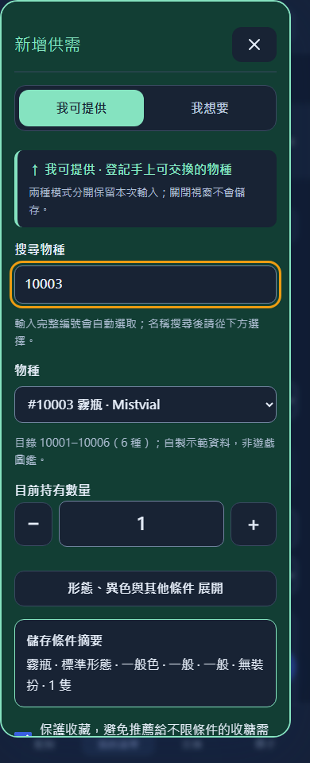
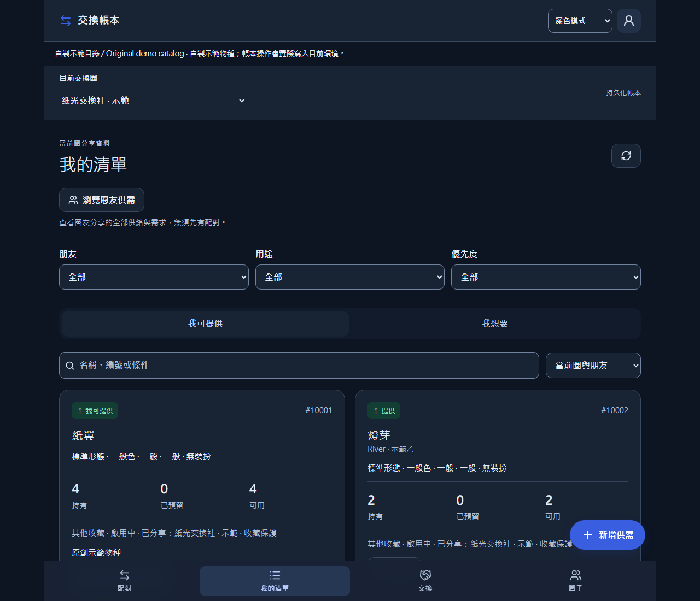
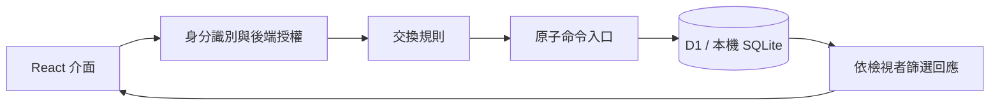

# Trade Ledger · 交換帳本

**從 Pokémon GO 玩家需求出發，協助私人社群安排交換的全端應用程式。**

分享自己能提供和想要的品項、瀏覽朋友的清單，再提出雙向交換計畫。即使同一筆供需分享到多個圈，交換帳本仍能追蹤哪些數量可用、哪些已答應給別人，以及哪些已經完成交換。

[English](README.md) · [本機體驗](#本機體驗) · [工程設計與取捨](#工程設計與取捨) · [程式碼導覽](docs/PORTFOLIO.md) · [CI 結果](https://github.com/HaNa-486/PokemonGOTradeListTool_public/actions/workflows/ci.yml)

## 解決什麼問題？

聊天群或試算表可以列出「我有什麼」，但安排交換還要回答：**這隻是否已被預留？雙方同意的是不是同一版內容？這次到底交換了幾隻？**

例如，一位玩家將同一筆 3 隻的供給分享到兩個圈。在其中一圈答應交換 2 隻後，兩個圈都只能再看到 1 隻可用：

| 操作 | 持有 | 已預留 | 兩圈共用的可用數量 |
|---|---:|---:|---:|
| 將同一筆供給分享到兩圈 | 3 | 0 | 3 |
| 雙方同意交換 2 隻 | 3 | 2 | 1 |
| 確認其中 1 隻已交付 | 2 | 1 | 1 |

本工具協助記錄和協調玩家自行安排的交換，沒有連接遊戲帳號或代為執行遊戲內交易。

## 可以怎麼使用？

**建立供需 → 瀏覽或配對 → 提案 → 雙方同意 → 預留 → 回報與確認完成。**

- **組織私人交換圈：** 邀請及核准成員、跨圈分享同一份供需，並授予明確範圍的代管權限。
- **尋找及提出交換：** 瀏覽圈友完整的已分享清單，或依條件配對；對方還沒刊登需求，也能收到主動提案。
- **追蹤交換進度：** 修訂雙方品項、同意後預留、分批完成，以及保留更正紀錄。
- **控制瀏覽與備份：** 個人隱藏／恢復與影響全圈的管理功能分開；個人匯出匯入和維運備份各有存取規則。

介面以**繁體中文**為主，提供手機版型、供給／需求分色，以及跟隨系統、淺色和深色模式。

<p>
  
  
</p>

社群版內附 **6 種原創虛構物種**，方便重現本機示範；截圖也使用這些物種與合成帳號。未隨附真實遊戲圖鑑或美術素材。

## 工程設計與取捨

| 問題 | 設計選擇與原因 | 實作依據 |
|---|---|---|
| 同一份庫存出現在不同交換圈。 | **一筆供需，多個分享範圍。** 數量與進度屬於同一筆記錄；分享不會複製庫存，避免各圈各自扣帳後失去一致性。 | [資料模型](core/model.ts) · [資料寫入](core/store.ts) · [帳本測試](tests/ledger.test.ts) |
| 兩個請求搶最後一隻，或使用者重送請求。 | **原子命令與綁定內容的重試收據。** epoch／版本檢查與 SQL CHECK guard 保護同一批 D1 寫入，帳本變更、audit 與收據一起成功或回滾；重送不能重複扣帳，同一識別碼也不能改送不同內容。 | [命令入口](core/store.ts) · [本機 D1 測試](tests/d1.test.ts) |
| 預留前修改提案，或交換只完成一部分。 | **同意綁定提案版本。** 修訂會重設同意；預留數量、完成批次與更正都會明確追蹤，能分辨雙方答應什麼、後來又改變什麼。 | [交換規則](core/service.ts) · [完成測試](tests/ledger.test.ts) |
| 私人圈彼此重疊，成員與代管者權限不同。 | **後端授權，再依檢視者篩選回應。** 新請求和重播請求都檢查目前權限，回應也會移除未授權圈的參照，不能靠改前端狀態取得權限。 | [API](server/api.ts) · [重播檢查](core/replay.ts) · [回應過濾](server/projection.ts) |

這些選擇有代價。**全站共用的 epoch 會產生寫入競爭**，換來較小且容易驗證的一致性機制；明確同意會增加操作步驟；依檢視者處理回應，也需要更多權限測試。這些是設計取捨，沒有宣稱具備大規模正式吞吐量。

領域條件也不能模糊處理：**未知、沒有、false 與不限是不同狀態**。未指定的形態或異色條件，不能被當成一般狀態直接合併。完整說明見[架構與取捨](docs/ARCHITECTURE.md)。

## 技術組成與請求流程

- **介面：** React、TypeScript、Tailwind CSS。
- **應用執行環境：** Worker 上的 Vinext／Vite，搭配後端 API 與登入介接。
- **資料：** Cloudflare D1；示範使用 SQLite 保存的本機 D1；Drizzle 管理 schema／migration，Zod 驗證資料。
- **驗證：** Node 測試、本機 D1 整合測試、Playwright 瀏覽器流程、Python 儲存庫檢查與 GitHub Actions。



帳本資料保存在後端資料庫；瀏覽器儲存空間用於偏好及未送出的草稿。頁面啟用期間透過輪詢取得更新。

## 本機體驗

使用 **Node.js 24、npm 與 Git**；貢獻者檢查另外使用 **Python 3.12**。本機示範不需要雲端帳號或 OAuth 憑證。

```sh
git clone https://github.com/HaNa-486/PokemonGOTradeListTool_public.git
cd PokemonGOTradeListTool_public
npm ci
npx playwright install chromium
npm run build
npm run demo:setup
```

Linux 若缺少 Chromium 系統函式庫，可使用 `npx playwright install --with-deps chromium`。首次安裝可能需要數分鐘。

在一個終端機啟動伺服器：

```sh
npm run demo:start
```

在第二個終端機開啟兩位示範使用者：

```sh
npm run demo:open
```

這會在 `https://127.0.0.1:8787` 開啟 **Alex · 示範甲**與 **River · 示範乙**兩個隔離的瀏覽器環境。操作時保持兩個終端機執行；在第二個終端機按 Enter 會關閉瀏覽器視窗。

**試做第一筆交換：**

1. 在 Alex 視窗的**圈子**建立交換圈及邀請連結。把連結開在已登入的 River 視窗，申請加入，再由 Alex 核准。
2. 兩個帳號各自透過**新增供需 → 我可提供**建立供給：Alex 選 `10001` 紙翼 / Paperwing，River 選 `10002` 燈芽 / Lamplume。使用標準形態、無裝扮，各 **3** 隻，並在**分享範圍**勾選該圈。
3. 瀏覽對方清單，選擇**向他主動提案**，提出雙方各交換 **2** 隻。雙方同意後，每筆供給會有 2 隻已預留、1 隻可用。
4. 回報雙方各交付 **1** 隻，再由另一個帳號確認該批完成。每筆供給會剩下持有 2 隻、已預留 1 隻、可用 1 隻。

[逐步操作導覽](docs/PORTFOLIO.md#local-walkthrough)提供明確數量與每一步的預期結果。

初始化只建立使用者，沒有預建圈或庫存，而且會拒絕覆蓋既有示範資料。Session 有效 **24 小時**；期間再次使用只需 `demo:start`、`demo:open`，不要重跑 setup。過期或遇到問題時，請依[本機設定與復原說明](docs/DEPLOYMENT.md)處理。

示範使用真正的 API、持久化本機 D1 與預先建立的測試 session，驗證的是業務流程，**不代表 Google／ChatGPT 真人登入已驗證**。網站託管與真實登入需另外設定及驗收，見[部署文件](docs/DEPLOYMENT.md)。

## 驗證與目前限制

已記錄的基準版本通過 **68 個應用測試、20 個同步／公開內容測試、8 個儲存庫檢查測試**，以及兩個使用本機 D1 的 Chromium 流程。瀏覽器驗證涵蓋雙向修訂、預留、部分完成與可見性復原；編輯介面檢查涵蓋 360、390、430、768、1280 寬度的深淺色模式。詳見[驗證紀錄](docs/VERIFICATION.md)及[實際 CI 結果](https://github.com/HaNa-486/PokemonGOTradeListTool_public/actions/workflows/ci.yml)。

重現貢獻者檢查：

```sh
npm run check:repository
npm run test:repository
npm run check:public
npm run test:public
npm run typecheck
npm test
npm run build
```

建置與一次性初始化完成後，先停止既有示範伺服器，再執行 `npm run demo:ci`。它會在本機 8787 埠啟動自己的伺服器、跑兩個瀏覽器流程，結束後關閉該伺服器。已有 `demo:start` 在執行時，可用 `npm run demo:qa` 僅執行交換流程。CI 不部署網站，也不使用正式環境 secrets。

**仍待完成的項目：**

- 真人 provider 登入、部署後的登入信任邊界及兩位真實雲端使用者尚待驗收；跨 provider 安全帳號綁定未實作。
- 實體裝置、無障礙、正式容量與正式災難復原尚未驗證。
- 尚無獨立持久化的計畫 `draft`／`disputed` 狀態；互補配對不會一次計算所有尚未載入頁面的完整集合。

## 使用、貢獻與延伸

- **體驗產品：** 依上方本機導覽操作，內附示範可獨立執行，不需要存取原應用程式。
- **參與貢獻：** 從可重現的錯誤、文件改善、無障礙或回歸測試著手。先讀[貢獻指南](CONTRIBUTING.md)，較大的功能變更請先開 issue 討論。
- **自備目錄：** 依[資料包規格](docs/DATASETS.md)記錄來源與權利。帳本會綁定確切資料包識別及雜湊；即使更新目錄，也需要新資料庫或另行審查的遷移。
- **部署與維護：** 參考[部署](docs/DEPLOYMENT.md)、[備份](docs/BACKUP.md)及[來源同步](docs/SYNC.md)文件。
- **回報漏洞：** 使用[安全政策](SECURITY.md)說明的私下回報方式。

## 專案分工與授權

擁有者定義產品需求、提供使用回饋並決定發布。開發採 AI 協作：Codex 協助實作、測試與文件；[作品集導覽](docs/PORTFOLIO.md)將設計決策連結到程式碼及可重現的情境。

原創程式、文件、測試及虛構示範資料採 [MIT 授權](LICENSE)；第三方元件保留[各自聲明](THIRD_PARTY_NOTICES.md)。MIT 不授予第三方商標或遊戲素材的權利。

本專案與 Pokémon、Nintendo、Niantic、Scopely 或 OpenAI 沒有官方關係，也未宣稱獲得其認可。儲存庫名稱反映原始的 Pokémon GO 使用情境。
