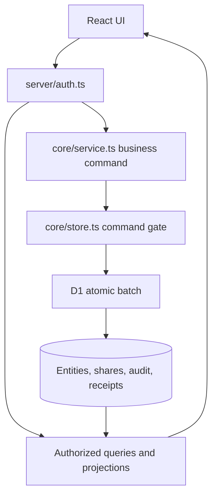

# Architecture and tradeoffs

Trade Ledger separates presentation, identity, domain commands, persistence, and actor-specific projections. The same application API powers the synthetic local demo and a correctly configured deployment; the demo substitutes test identity setup, not the business rules.

## Request path

`build/sites-worker.ts` routes API and authentication requests to server modules and page requests to Vinext. Sites supplies a D1 binding in a deployed environment; Wrangler supplies SQLite-backed local D1 for the demo.

## Identity is a separate boundary

The deployed Sites adapter accepts platform identity only when explicitly enabled behind the trusted dispatcher and an exact configured origin. An origin match is defense in depth, not a signature. Standalone hosts cannot safely copy that header trust.

Google OIDC uses authorization code, PKCE, state, nonce, and signed-token validation. Sessions are random, stored as hashes, and delivered in secure HttpOnly cookies. Real-provider behavior and deployment routing require their own verification. Cross-provider account linking is not implemented.

Local demo setup refuses existing demo state or sessions and seeds two synthetic sessions valid for 24 hours; browser automation supplies them only to loopback contexts. Normal authorization, Origin, projection, and command checks remain in place.

## Data model

| Storage | Responsibility |
|---|---|
| users / identities / sessions / oauth_flows | Internal identity mappings and authentication state |
| entities | Versioned circles, grants, listings, plans, completion/correction records, visibility preferences, and imports |
| shares | Many-to-many listing/circle visibility; never copied stock |
| audit_events | Actor/owner distinction, reasons, snapshots, and quantity changes |
| idempotency_records | Actor, operation, key, payload hash, and replay result |
| epochs / transaction_guards | Concurrent-write precondition and SQL rollback gate |
| dataset_bindings | Immutable catalog ID, schema version, version, kind, and content hash for this ledger |

Entities contain validated JSON aggregates rather than a fully normalized row for every plan item or circle member. This keeps domain transitions together but requires application invariants and limits the practical size of aggregates.

Dataset identity compares catalog ID, schema version, version, kind, and content hash exactly. The first business command binds an empty ledger atomically; an occupied legacy ledger is not silently adopted. Changing even a catalog version or label changes the binding requirements. There is no hot-reload upgrade path: use a reviewed migration or a new database, never force-edit the binding row. The bundled six-item catalog is fictional.

## Atomic command path

1. Check idempotency key and canonical payload hash. On a replay, recheck current authorization.
2. Read the current epoch and authorized data into a request-local unit of work.
3. Validate domain rules and explicit record versions.
4. Execute one D1 batch: conditional epoch update, SQL CHECK guard, entity/share changes, audit, receipt, and guard cleanup.
5. A zero-row epoch update fails the CHECK and rolls back the entire batch. Retry epoch contention within a bounded loop; explicit version conflicts remain conflicts.

There is no in-process lock protecting shared stock and no browser-owned inventory. The global epoch trades write throughput for a small, testable consistency mechanism. Formal production capacity is not claimed.

## Quantities and consent

Supply availability is held minus reserved. Finite demand capacity is target minus fulfilled minus reserved; an ongoing demand has no finite target. Proposal revisions invalidate prior consent. Both parties agree before reservation; pending delivery keeps capacity occupied until a valid confirmation or mutual cancellation.

Completion history binds the original species and traits. Corrections append records; they do not rewrite the past into a different item. Receiving an item does not automatically add supply.

## Visibility, reads, and synchronization

Authorized SQL queries apply filters and personal hiding before pagination. Shared pairs are deduplicated across circles; matching uses a stable global order and bounded pages. Response projections remove unauthorized circle references and private fields.

Personal hiding belongs to the viewer. Administrator removal affects a circle's share; restoration is tied to an exact eligible audit record and cannot overwrite subsequent owner changes.

The UI polls revisions while active, stops in the background or after inactivity, and rejects stale responses after scope changes. Browser storage holds preferences, recent selections, and explicitly saved unsent drafts—not an offline settlement queue.

## Recovery and limits

Full backups use schema version 2, include the persisted dataset binding, are restricted to explicit maintenance IDs, and exclude active authentication secrets. Personal JSON exports also use schema version 2. Import/restore reject version 1 and nonmatching dataset identity. Validation checks structure and ledger conservation; the restore utility accepts a new local SQLite file only. See [BACKUP.md](BACKUP.md).

Separate acceptance is still needed for real OAuth, dispatcher bypass resistance, two real users, physical devices, assistive technology, production capacity, and production disaster recovery. Independent persisted plan draft/disputed states and a full complementary set across every unloaded page remain roadmap items.
